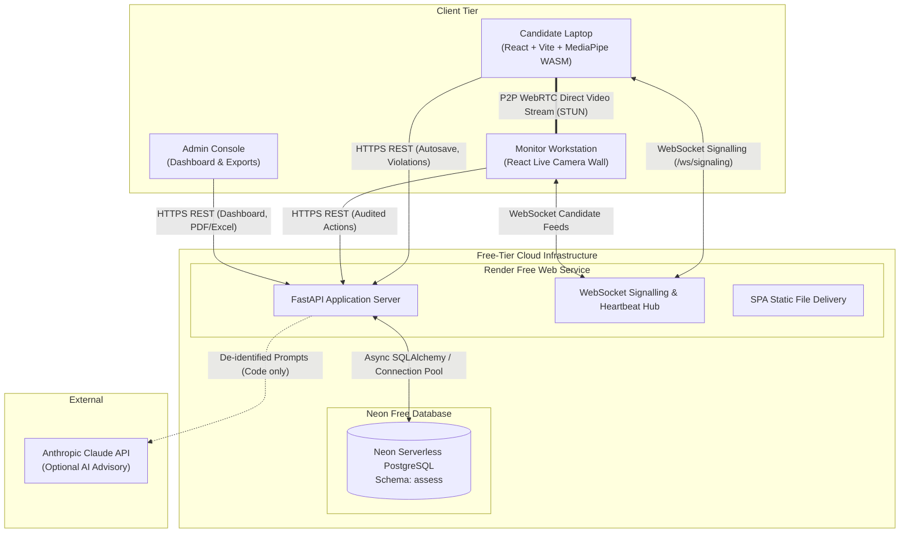
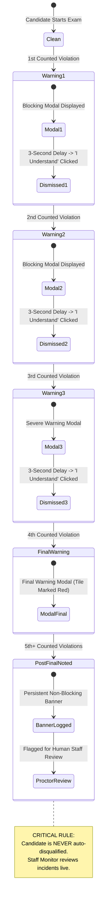
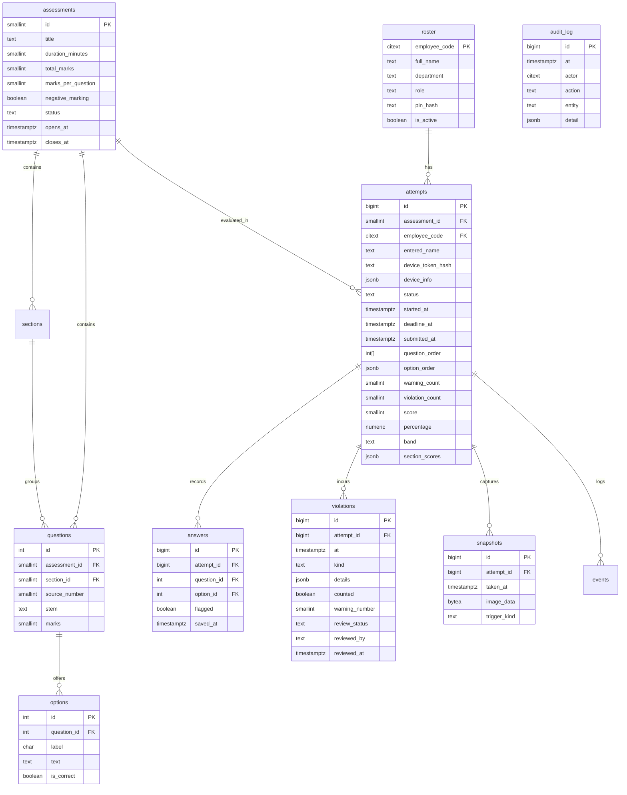

# System Architecture & Technical Specifications

This document outlines the architectural blueprints, data flow diagrams, security boundaries, and state machines governing the HR Assessment Portal.

---

## 1. High-Level System Architecture



---

## 2. WebRTC Peer-to-Peer Signalling & Automatic Fallback

Live video monitoring connects candidate webcams directly to the monitor's workstation without burdening the server or exceeding free-tier bandwidth caps.

```mermaid
sequenceDiagram
    autonumber
    actor Candidate as Candidate Laptop
    participant Server as FastAPI WebSocket Signalling
    actor Monitor as Staff Monitor Wall

    Candidate->>Server: Connect WS (/ws/signaling?role=CANDIDATE&attempt_id=X)
    Monitor->>Server: Connect WS (/ws/signaling?role=MONITOR)
    Server-->>Monitor: Candidate Online Notification (Attempt X)
    Monitor->>Server: Send WebRTC Offer (SDP)
    Server->>Candidate: Relay Offer
    Candidate->>Server: Send WebRTC Answer (SDP)
    Server->>Monitor: Relay Answer
    Candidate->>Server: Exchange ICE Candidates
    Server->>Monitor: Relay ICE Candidates
    Candidate==>>Monitor: Direct P2P Video Track Established (STUN)

    Note over Candidate,Monitor: If P2P connection fails within 10s (e.g. Symmetric NAT/Firewall)
    Candidate->>Server: Fallback: Send 240px JPEG Snapshot (every 5s)
    Server->>Monitor: Relay Snapshot Frame (Tagged: 'Snapshot Mode')
```

---

## 3. Proctoring Warning State Machine

The proctoring system implements a human-in-the-loop, non-disqualifying model:



---

## 4. Database Entity-Relationship Model (Schema: `assess`)



---

## 5. Free-Tier Optimization & Durability Invariants

1. **Deterministic Question Randomization**:
   When an attempt is initialized, questions and options are randomized once and the resulting permutation arrays (`question_order: int[]` and `option_order: jsonb`) are written to Postgres. On subsequent fetches (e.g. after browser refresh or server reboot), questions are returned in the exact stored order.
2. **Immutable Audit Trail**:
   PostgreSQL trigger `trg_prevent_audit_tampering` raises an exception on any `UPDATE` or `DELETE` attempt against `assess.audit_log`.
3. **Submission State Lock**:
   PostgreSQL trigger `trg_lock_answers_on_submit` rejects any `INSERT` or `UPDATE` on `assess.answers` once the associated attempt's status transitions away from `IN_PROGRESS`.
4. **Neon Scale-to-Zero Connection Resilience**:
   `engine = create_engine(..., pool_size=5, max_overflow=2, pool_pre_ping=True, pool_recycle=300)`. A custom retry wrapper handles cold-start latency transparently.
